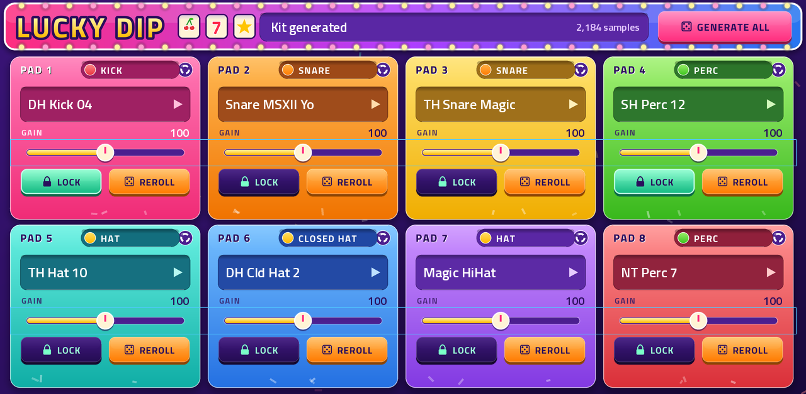
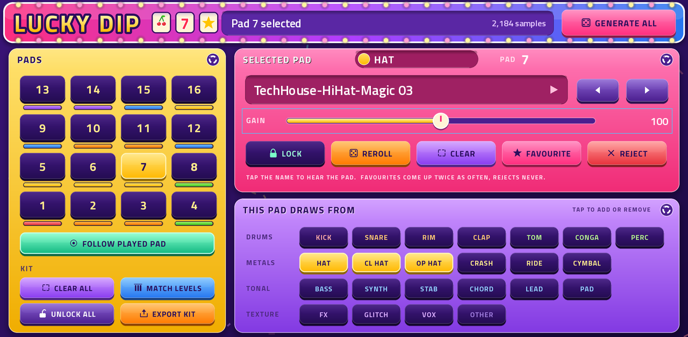
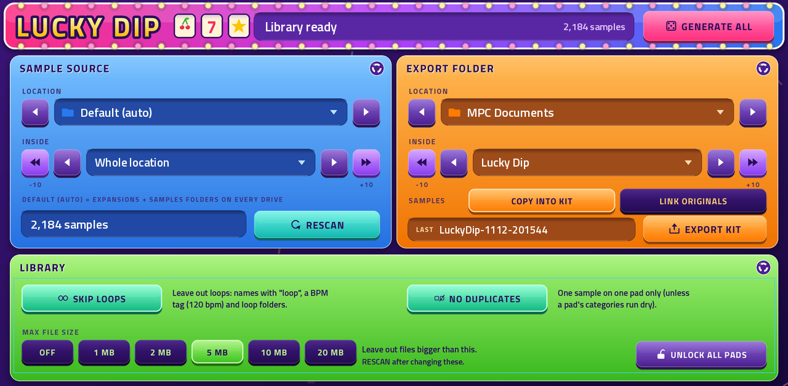
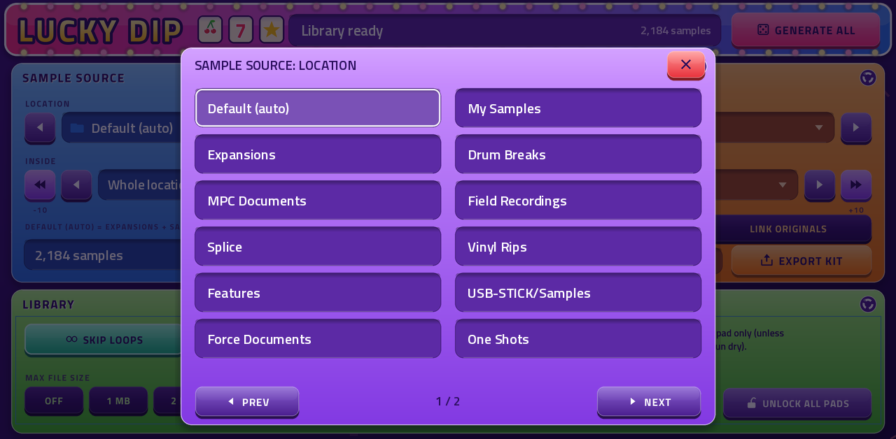

# Lucky Dip

**A random drum-kit builder and inspiration machine for Akai MPC and Force.**

Your sample library is bigger than you remember. Lucky Dip reaches in, pulls out sixteen sounds, drops them on the pads and
lets you play them straight away. Don't like one? Reroll it. Love one? Lock it and dip again. When the kit feels right,
export it as a normal MPC drum program.

It's a way to **find the samples you forgot you had**: the pack you downloaded and never opened, the odd hit buried three
folders deep, the old recording you made years ago. Every dip is a surprise, and some of them are good.



Lucky Dip is a native plugin (VST2) for MPC OS standalone devices, with its own MPC screen and Q-Links. It runs on the
**MPC Live III** (64-bit) and on the **Akai Force** and first-generation standalone MPCs (32-bit).

## What's new in 1.0
- **A new screen**, in the familiar candy colours: tap a sample's name to hear it, see at a glance what each pad drew
  (a coloured category band), select pads on an MPC-style 4x4 grid, and pick folders from a list.
- **Works on the MPC Live III**, and finds your samples on any unit: the internal drive, SD cards and USB sticks are found
  automatically, and folders show where they are (`Internal / Expansions`, `MYSTICK / Samples`).
- **SETTINGS is clearer**: three cards (where samples come from, where kits go, library rules), folder pick-lists, and
  one-tap choices for the export mode and the maximum file size.
- Pads keep their pitch when the project runs at 48 kHz, and playback never waits for the library.
- Projects saved with Lucky Dip 0.9 load as before: same plugin, same kit, same settings.

## What it does
- **Scans your sample folders** and sorts every sample into one of 23 categories (kick, snare, rim, clap, hat, closed hat,
  open hat, tom, conga, percussion, crash, ride, cymbal, fx, glitch, vox, bass, synth, stab, chord, lead, pad, other) from the
  folder and file names. No tagging by hand.
- **Fills 16 pads at random.** Pad 1 draws a kick, pad 2 a snare, pad 5 a hat and so on, like a real drum kit. Pads 12-15 draw
  from everything else (vocals, bass, synths, chords, glitches...) for the surprises.
- **Plays the kit.** Hit the pads, or play it from the sequencer, and hear it before you commit to anything.
- **Lets you steer.** Lock the pads you like, reroll the ones you don't, change what a pad is allowed to pick from, mark
  favourites (more likely to come up) and rejects (never again).
- **Matches levels** so a loud sample doesn't swamp a quiet one.
- **Exports an MPC drum program** (`.xpm`) that you can load like any other kit.

## Requirements
- An MPC OS standalone device: MPC Live III, Akai Force, MPC Live / Live II / One / X / Key 61. Tested on a **Live III** and a
  **Force** (MPC OS 3.9.1). MPC OS 3.x is needed (the 0.9 build is the last one listed for 2.x).
- Samples as **WAV** (8/16/24-bit, 32-bit, 32-bit float; mono or stereo; any sample rate) or **AIFF**, on the internal drive,
  a card or a USB stick. Compressed WAV isn't supported. Very long files are cut to 15 seconds on the pad (Lucky Dip is for
  one-shots).

## Install
Download the zip for your device from this repo's **Releases** page:
- `Lucky-Dip-<version>-mpc-aarch64.zip`: **MPC Live III** and other 64-bit units.
- `Lucky-Dip-<version>-mpc-armv7.zip`: **Force**, MPC Live / Live II / One / X / Key 61.

**With the Plugin Manager** (from [mpc-vst-plugins](https://github.com/sd88me/mpc-vst-plugins)): install Lucky Dip from the
catalog, or upload the zip.

**By hand** (needs root SSH access; installing plugins this way is unofficial, so back up first and use it at your own risk):
copy the zip to the device, unzip it and run its installer: `sh install.sh`. It stops MPC (**save your project first**), puts
Lucky Dip in place, registers it and starts MPC again. Running it again upgrades in place and keeps your own files
(`luckydip/`: the sample index, favourites and rejects).

Then add a track and choose **Lucky Dip** as its plugin (on a Live III it is listed under External Plugins; Preferences →
Enhancements must have External Plugin Support on).

**Upgrading from 0.9:** install over it as above. Your projects, favourites and rejects carry over. Remove Lucky Dip from every
track (or reopen the project) after updating: MPC keeps a plugin loaded while any instance of it exists.

## Quick start
1. Add a **Lucky Dip** track. The first time, it scans your drives in the background; the banner shows the sample count when
   it's done.
2. Press **GENERATE ALL**. Sixteen samples land on the pads; the names and categories appear on the tiles.
3. Play the pads, or tap a sample's name to hear it.
4. Don't like a pad? **REROLL** it. Like one? **LOCK** it, then **GENERATE ALL** again: locked pads keep their sample.
5. Happy with the kit? Press **EXPORT KIT** (PAD EDIT or SETTINGS). Your new program appears in the browser.

Pads answer MIDI notes 0-15 (the 16-pad drum layout) and 36-51, so they work from the pads, a keyboard or a sequence.

## The pages

### PADS 1-8 and PADS 9-16
One tile per pad: the category it drew, the sample name (tap it to hear the pad), a **GAIN** slider, **LOCK** and **REROLL**.
Q-Links turn the gains (two blocks of four per page). **GENERATE ALL** is in the banner on every page, next to the status line
and the library's sample count.

### PAD EDIT


Everything about one pad.
- **PADS**: tap a pad on the 4x4 grid to edit it (laid out like the MPC's pads); the coloured bar under each pad shows what it
  holds. With **FOLLOW PLAYED PAD** on, the page follows the last pad you played; turn it off to edit one pad while playing others.
- **SELECTED PAD**: its category and sample (tap the name to hear it), **GAIN**, **LOCK**, **REROLL**, **CLEAR**,
  **FAVOURITE** (twice as likely to come up in future dips, on any kit) and **REJECT** (never picked again, until you change
  your mind in `prefs.txt`; then **REROLL** for a new one).
- **THIS PAD DRAWS FROM**: which categories the pad may pick from, grouped as drums, metals, tonal and texture. The lit keys are
  the pad's pool, which starts as that pad's usual categories. Tap to add or remove, for example make pad 1 draw kicks *and* bass.
- **KIT**: **CLEAR ALL** (empty every unlocked pad), **MATCH LEVELS**, **UNLOCK ALL** and **EXPORT KIT**.

### SETTINGS


Where Lucky Dip looks, where it saves, and how it behaves. Changes are saved with your project.

| Setting | What it does |
|---|---|
| **SAMPLE SOURCE: LOCATION** | The place to draw samples from. `Default (auto)` means the `Expansions` and `Samples` folders on every drive. Or pick any folder at the top of a drive. Tap the field for a list, or step with the arrows. |
| **SAMPLE SOURCE: INSIDE** | Optionally narrow it to one folder inside that location, for example a single pack. The double arrows jump 10 folders. |
| **RESCAN** | Rebuilds the sample list. Press it after changing the source or the library rules. The list is saved between sessions, so startup is quick. |
| **EXPORT FOLDER** | Where exported kits are saved, chosen the same way. The default is the Force's `Expansions/Kits & Patterns` folder (where it browses for kits), else `MPC Documents/Lucky Dip` on a Live III, else a `kits` folder inside the plugin's `luckydip` folder. |
| **SAMPLES: COPY INTO KIT / LINK ORIGINALS** | Copy puts a copy of every sample next to the exported program, so the kit is self-contained. Link makes links instead, so nothing is duplicated, but the originals must stay where they are (and the drive must support links, otherwise it copies). |
| **SKIP LOOPS** | Leaves out files whose names look like loops ("loop", "Lp", a BPM tag such as `120 bpm` or `[120]`) and whole folders named like loops ("Clips & Loops"). On by default. |
| **NO DUPLICATES** | A sample is used on only one pad of a kit. If a pad's pool runs out of unused samples it may repeat one rather than stay empty. |
| **MAX FILE SIZE** | Leaves out files bigger than this (Off, 1, 2, 5, 10 or 20 MB). Keeps long recordings and loops out of a drum kit. |
| **UNLOCK ALL PADS** | Unlocks every pad. |



## Good to know
- **Your kit is saved with the project**: the samples (by location), locks, gains, category choices and settings. Samples
  aren't copied into the project, so if you move or delete one, its tile shows "MISSING" and `!` before the name.
- **Gain and MATCH LEVELS** change how the pads sound in the plugin. An exported program uses each sample at its own level.
- **Exported programs** are standard 128-pad MPC drum programs with your 16 samples on pads 1-16, named
  `LuckyDip-MMDD-HHMMSS`. Pad colours follow the category.
- **Pads are one-shots**: no pitch, envelope or choke groups; hitting a pad again restarts it.
- **Several Lucky Dip tracks share one sample list.** If they use different sources, the last rescan wins.
- **How samples are sorted**: by the folder names above the file first (the deepest matching one wins), then the file name. A
  folder called `Kicks`, or a file called `punchy_kick_01.wav`, is a kick. Unnamed folders end up in "other", which only the
  catch-all pads draw from.

## Files and the config file
Lucky Dip keeps a `luckydip` folder inside its plugin folder:
- `index.cache`: the saved sample list (delete it to force a fresh scan).
- `prefs.txt`: your favourites (`F`) and rejects (`R`), one path per line. Edit it to undo a reject.
- `luckydip.conf` (optional, create it yourself): sets what `Default (auto)` means, for places the SETTINGS page can't reach.
  ```
  root=/media/<card>/My Samples      # repeatable: every root= line is scanned
  export_dir=/media/<card>/My Kits
  skip_loops=1
  max_mb=5
  ```
- `kits/`: only used when there's no better export folder.

## 16-pad drum layout (optional, advanced)
By default MPC treats a plugin track as a keyboard. A separate, optional patch from
[mpc-vst-plugins](https://github.com/sd88me/mpc-vst-plugins) (`tools/mpc_patch/`) makes MPC show the proper 16-pad drum layout
for Lucky Dip (and a few other drum plugins) on the firmware it supports. Read its README first. Lucky Dip works fine without it.

## Building from source
Built with the MPC plugin builder (`tools/build.py`, set `MPC_BUILDER` to its checkout):
```
./build.sh          # build/"sd88me - VST - Lucky Dip"/: the 32-bit and 64-bit plugin and its screen (Plugin Skins/)
./build.sh test     # plus the offline host test (tests/run.sh, ASan/UBSan) and the builder's host simulator
./build.sh beta     # "Lucky Dip 2 Beta" with its own id, to install next to the release
tools/package_catalog.sh   # dist/: the release zips, one per CPU
```
- `src/engine.cpp` is the kit engine; `src/LuckyDipPlugin.cpp` is the plugin around it. The parameter order is frozen in
  `vst/params.lock` (`tools/gen_params.py` refuses changes; new parameters are appended).
- The screen is generated: `tools/make_tui.py` (pages and controls) and `tools/ld_art.py` (all art, drawn from code);
  `python3 tools/make_tui.py --preview` writes `docs/skin-preview/`.
- The 0.9 build (`vst/`, `vendor/mpc-vst/`) is kept for reference. More detail is in `docs/NOTES.md`; planned work in `docs/ROADMAP.md`.

## Credits
The kit-building engine (sample classification, seeded random assignment, loudness matching, MPC program export) originated in
[schwung-kit-builder](https://github.com/sd88me/schwung-kit-builder) and was ported to
[force-kit-builder](https://github.com/sd88me/force-kit-builder), which Lucky Dip follows. Screen text uses Titillium Web (SIL
Open Font License, `tools/fonts/OFL.txt`). Built on [mpc-vst-plugins](https://github.com/sd88me/mpc-vst-plugins).

MIT licensed, see `LICENSE`.
